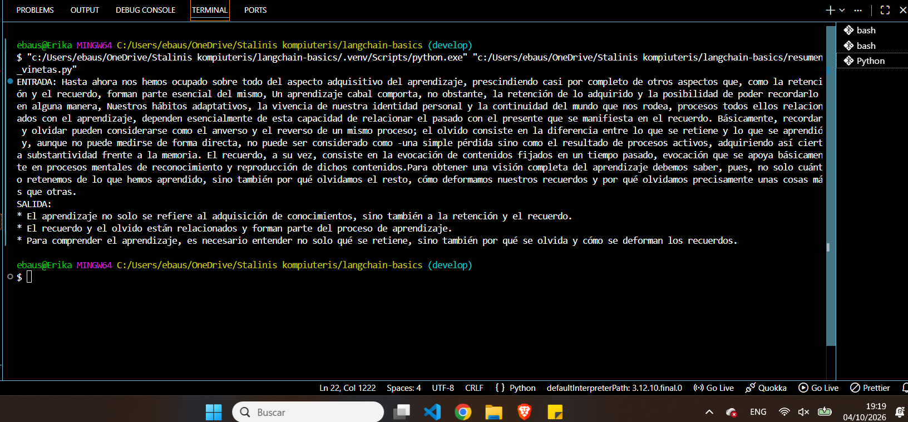
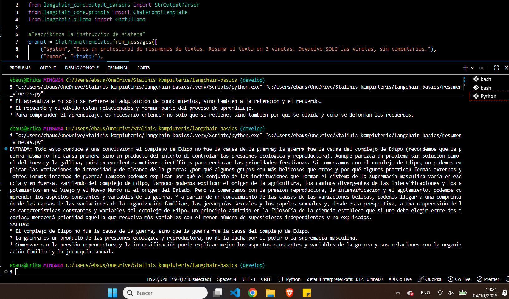

# Entrega: Cadena LCEL para Resumen en 3 Viñetas

Este repositorio contiene la solución al ejercicio práctico de construcción de una cadena utilizando **LangChain Expression Language (LCEL)**. El objetivo es procesar textos largos y generar un resumen estructurado estrictamente en **3 viñetas**.

## Estructura del Patrón: Prompt | Modelo | Parser

La arquitectura de la cadena sigue el flujo oficial de LangChain utilizando el operador pipe (`|`):

1. **Prompt (`ChatPromptTemplate`):** Configura la instrucción del sistema indicando el rol de resumidor profesional y la restricción de devolver *SOLO* 3 viñetas sin texto introductorio ni comentarios.
2. **Modelo (`ChatOllama`):** Conecta con el modelo local **`llama3.2:3b`** (Local). 
3. **Parser (`StrOutputParser`):** Limpia la salida directa del modelo, transformando los tokens generados en un string de texto limpio y legible.

## Evidencias de Ejecución (Punto 4)

A continuación se adjuntan las capturas de pantalla que demuestran el correcto funcionamiento del script con **2 textos de entrada completamente distintos**:

### Dos capturas de ejecución 

