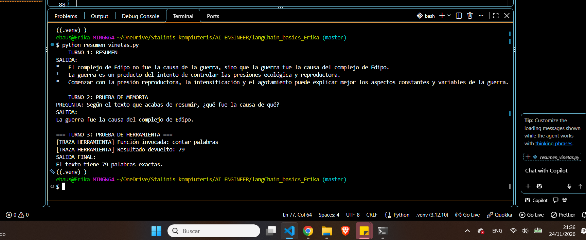
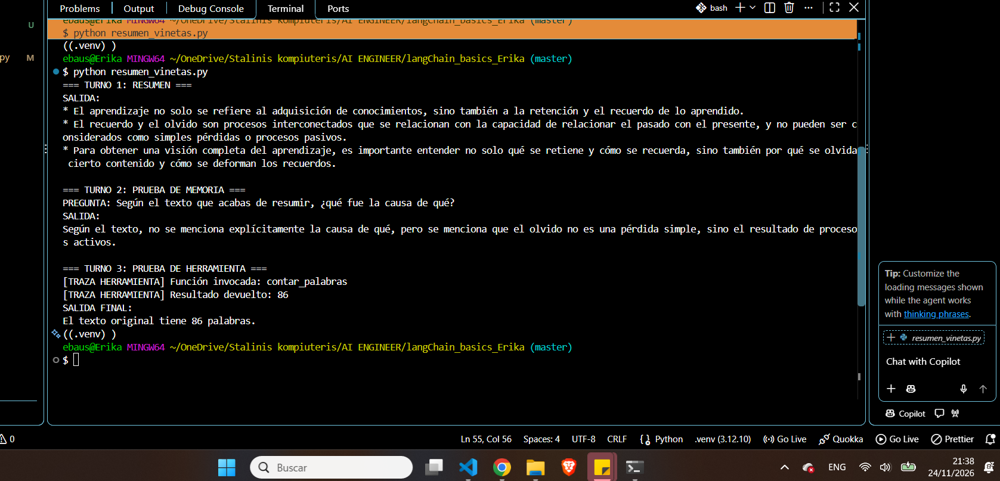

# 📝 Resumidor de Textos con LCEL, Memoria y Herramientas (LangChain + Ollama)

Este proyecto implementa un flujo conversacional utilizando **LangChain Expression Language (LCEL)** y el modelo local **Llama 3.2 (`llama3.2:3b`)** a través de Ollama. 

El sistema es capaz de resumir textos en 3 viñetas, recordar el contexto de turnos anteriores dentro de una misma sesión y ejecutar herramientas reales en Python cuando la consulta lo requiere.

---

## Características principales

1. **Arquitectura LCEL (`prompt | model | parser` ):** Estructura modular que conecta las instrucciones del sistema, el historial de conversación, el modelo de lenguaje y el formateador de salida.
   > **💡 Nota técnica sobre el Parser y las Herramientas:** En el código, la cadena base se define como `chain = prompt | model` y el `StrOutputParser` (`parser.invoke(...)`) se aplica justo después. Esto es necesario porque si se encadenara `| parser` directamente antes de comprobar `tool_calls`, el parser convertiría el objeto `AIMessage` en texto plano (`str`) y se perderían los metadatos de la invocación de la herramienta.
2. **Memoria Conversacional:** Uso de `MessagesPlaceholder` y listas de mensajes (`HumanMessage`, `AIMessage`, `ToolMessage`) para mantener el contexto entre múltiples turnos y responder preguntas sobre información previa.
3. **Integración de Herramientas (`@tool`):** Implementación de la función `contar_palabras(texto)` enlazada al modelo mediante `.bind_tools()`, mostrando en consola el resultado.

---

##  Ejemplo de flujo de ejecución (3 Turnos)

Al ejecutar `resumen_vinetas.py`, el programa realiza una prueba completa en 3 pasos:

* **Turno 1 (Resumen):** Recibe un texto y devuelve un resumen estructurado en 3 viñetas.
* **Turno 2 (Prueba de Memoria):** Se le realiza una pregunta sobre el texto anterior (*"Según el texto que acabas de resumir, ¿qué fue la causa de qué?"*), demostrando que recuerda el contexto del primer turno.
* **Turno 3 (Uso de Herramienta):** Se le solicita contar las palabras exactas del texto resumido. El modelo invoca la herramienta `contar_palabras`, imprime la traza y responde con el dato exacto calculado por Python.

---

## Capturas de ejecución

